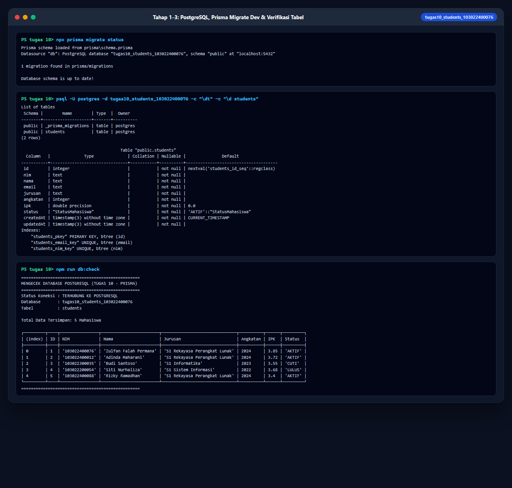
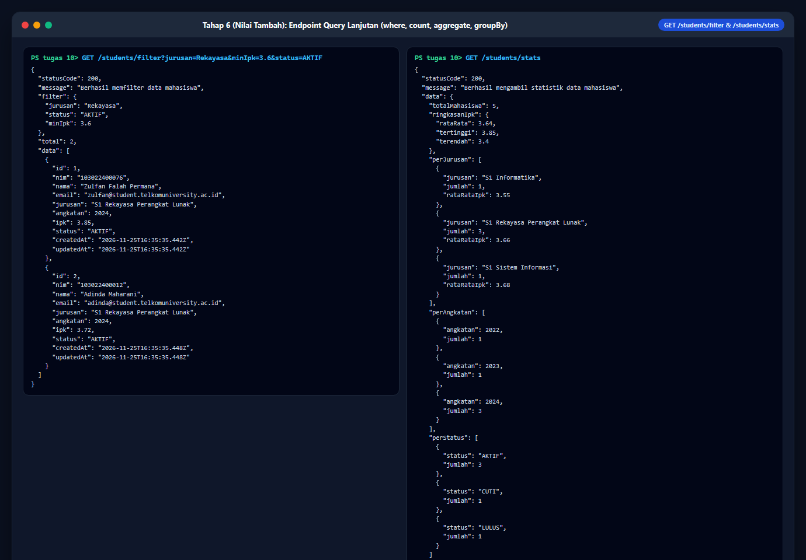
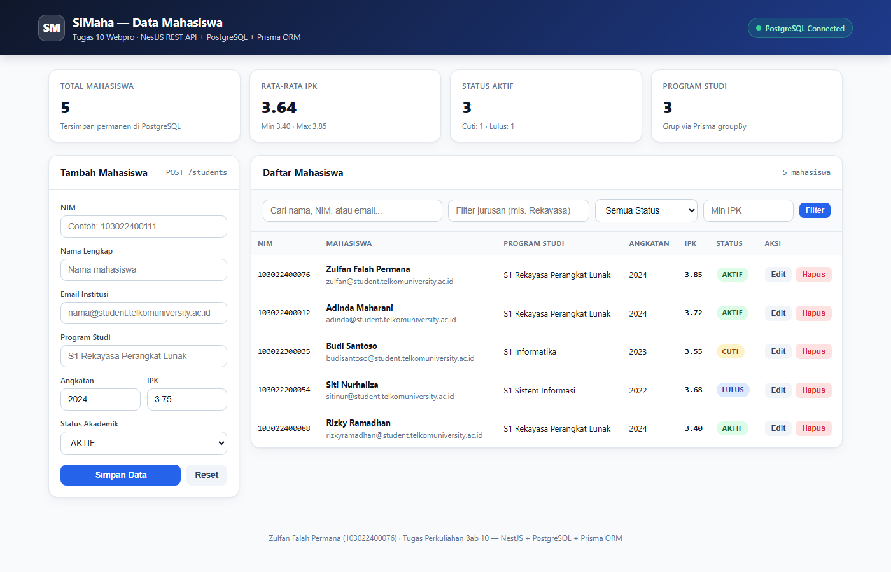
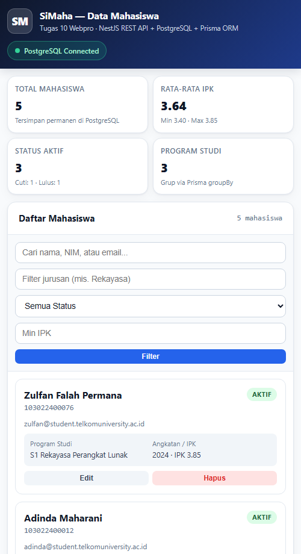

# SiMaha (Sistem Manajemen Data Mahasiswa)

Proyek ini dibuat untuk Tugas 10 mata kuliah Pemrograman Web. Isinya kelanjutan dari backend REST API di Tugas 09, yang sekarang sudah terhubung ke PostgreSQL pakai Prisma ORM supaya datanya tersimpan permanen dan tidak hilang waktu server di-restart.

- Nama: Zulfan Falah Permana
- NIM: 103022400076
- Mata Kuliah: Pemrograman Web

## Yang Dikerjakan di Tugas 10

- Bikin database lokal di PostgreSQL (`tugas10_students_103022400076`) dan atur model `Student` di `prisma/schema.prisma` (kolom `id`, `nim`, `nama`, `email`, `jurusan`, `angkatan`, `ipk`, enum `status`, `createdAt`, `updatedAt`).
- Jalankan migrasi awal lewat `npx prisma migrate dev --name init` dan seed 5 data mahasiswa awal.
- Buat `PrismaService` yang di-inject ke `StudentsService`, jadi controller tidak langsung akses database.
- Lengkapi operasi CRUD (`POST`, `GET`, `PATCH`/`PUT`, `DELETE`) dengan validasi input DTO (`ValidationPipe`) dan cek error untuk data duplikat (`409`) atau ID yang tidak ada (`404`).
- Tambah endpoint query lanjutan: filter data pakai `where` di `/students/filter` dan ringkasan statistik pakai `count`, `aggregate`, sama `groupBy` di `/students/stats`.
- Tambah tampilan web sederhana di `public/index.html` supaya bisa langsung dipakai dan dites di layar desktop maupun mobile.

## Daftar Endpoint

| Method | Path | Kegunaan |
| :--- | :--- | :--- |
| `GET` | `/students` | Ambil semua data mahasiswa (bisa tambah query filter juga) |
| `GET` | `/students/:id` | Ambil detail satu mahasiswa berdasarkan ID |
| `POST` | `/students` | Tambah data mahasiswa baru |
| `PATCH` / `PUT` | `/students/:id` | Ubah data mahasiswa |
| `DELETE` | `/students/:id` | Hapus data mahasiswa |
| `GET` | `/students/filter` | Filter berdasarkan `search`, `jurusan`, `angkatan`, `status`, atau `minIpk` |
| `GET` | `/students/stats` | Lihat jumlah total mahasiswa, ringkasan IPK, dan rekap per jurusan/angkatan/status |

## Cara Menjalankan

Pastikan PostgreSQL lokal sudah menyala, lalu jalankan perintah berikut di folder proyek:

```bash
npm install
cp .env.example .env
```

Sesuaikan `DATABASE_URL` di file `.env` dengan username dan password PostgreSQL masing-masing, lalu lanjutkan:

```bash
npx prisma migrate dev --name init
npm run prisma:seed
npm run build
npm run start:prod
```

Setelah server jalan, web bisa dibuka di `http://localhost:3000/` dan endpoint API di `http://localhost:3000/students`. Untuk testing API juga sudah disiapkan file `students.http` dan `postman_collection.json`.

## Screenshot Tahapan & Tampilan

### 1. Setup PostgreSQL, Migrasi Prisma, dan Cek Database


### 2. Pengujian CRUD dan Cek Data Setelah Restart Server


### 3. Endpoint Tambahan (Filter `where` dan Statistik `count` / `groupBy`)


### 4. Tampilan Desktop


### 5. Tampilan Mobile

