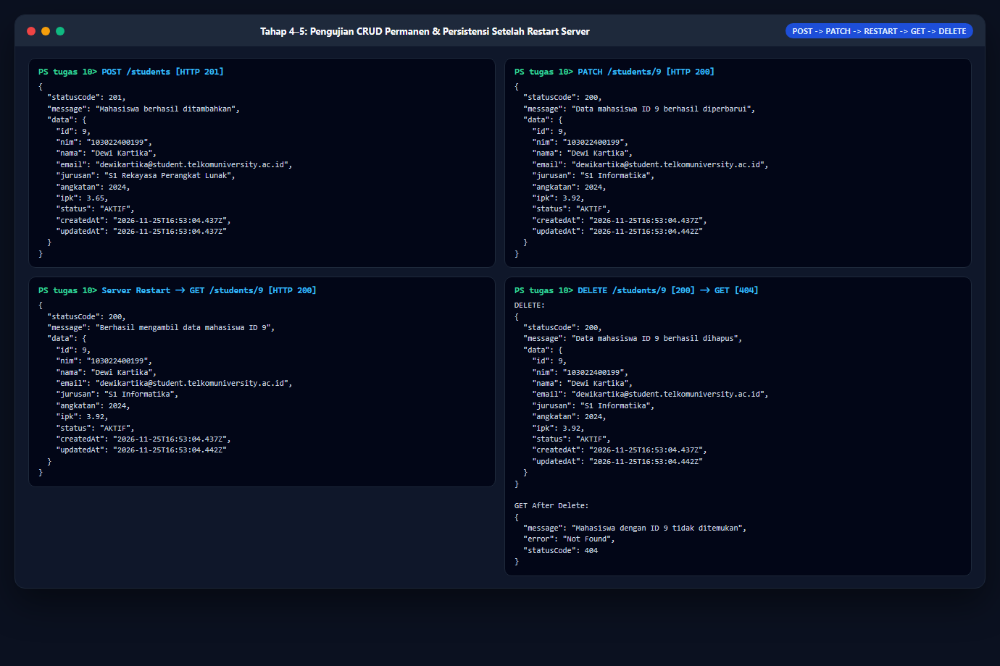

# SiMaha — Sistem Manajemen Data Mahasiswa (REST API + PostgreSQL + Prisma ORM)

Aplikasi web fullstack sederhana beserta backend REST API berbasis **NestJS**, **PostgreSQL**, dan **Prisma ORM** untuk mengelola data mahasiswa secara permanen. Proyek ini merupakan kelanjutan dari Tugas 09 (Pemrograman Web — Bab 10).

- **Nama** : Zulfan Falah Permana
- **NIM** : 103022400076
- **Mata Kuliah** : Pemrograman Web (Webpro)

---

## Fitur Utama

1. **Basis Data PostgreSQL & Prisma ORM** — Model `Student` (`students`) dengan enum `StatusMahasiswa` (`AKTIF`, `CUTI`, `LULUS`), unique constraint pada `nim` & `email`, serta migrasi resmi melalui `npx prisma migrate dev`.
2. **`PrismaService` Provider (`@Global`)** — Diinjeksikan ke `StudentsService` sehingga controller tetap bersih dan terpisah dari lapisan database.
3. **CRUD Permanen** — `POST`, `GET`, `PATCH`/`PUT`, dan `DELETE` pada `/students` lengkap dengan validasi DTO (`ValidationPipe`) dan penanganan error (`400`, `404`, `409`), tersimpan permanen setelah server di-restart.
4. **Query Lanjutan (Nilai Tambah)** — Filter multi-kriteria dengan Prisma `where` (`GET /students/filter` & query param pada `GET /students`) serta statistik agregasi (`GET /students/stats` menggunakan `count`, `aggregate`, dan `groupBy`).
5. **Antarmuka Web Responsif (Desktop & Mobile)** — Tersedia langsung pada `http://localhost:3000/` dan terhubung langsung ke REST API.

---

## Daftar Endpoint API

| Method | Endpoint | Deskripsi |
| :--- | :--- | :--- |
| `GET` | `/students` | Mengambil seluruh data mahasiswa (mendukung query filter) |
| `GET` | `/students/:id` | Mengambil detail mahasiswa berdasarkan ID |
| `POST` | `/students` | Menambahkan data mahasiswa baru |
| `PATCH` / `PUT` | `/students/:id` | Memperbarui data mahasiswa |
| `DELETE` | `/students/:id` | Menghapus data mahasiswa |
| `GET` | `/students/filter` | Filter lanjutan (`search`, `jurusan`, `angkatan`, `status`, `minIpk`) |
| `GET` | `/students/stats` | Statistik mahasiswa (`count`, rata-rata/min/max IPK, `groupBy`) |

---

## Cara Menjalankan Proyek

```bash
# 1. Install dependensi
npm install

# 2. Salin konfigurasi environment dan sesuaikan kredensial PostgreSQL
cp .env.example .env

# 3. Jalankan migrasi awal Prisma ke PostgreSQL
npx prisma migrate dev --name init

# 4. (Opsional) Seed data awal mahasiswa
npm run prisma:seed

# 5. Build dan jalankan server
npm run build
npm run start:prod
```

Buka `http://localhost:3000/` untuk antarmuka web atau `http://localhost:3000/students` untuk endpoint REST API. Koleksi pengujian juga tersedia pada `students.http` dan `postman_collection.json`.

---

## Dokumentasi Screenshot Tahapan & Tampilan

### 1. Tahap 1–3: PostgreSQL, Prisma Migrate & Verifikasi Tabel


### 2. Tahap 4–5: Pengujian CRUD & Persistensi Setelah Restart Server


### 3. Tahap 6 (Nilai Tambah): Endpoint Query Lanjutan (`where`, `count`, `groupBy`)


### 4. Tampilan Desktop (`1400x900`)


### 5. Tampilan Mobile (Responsif)

